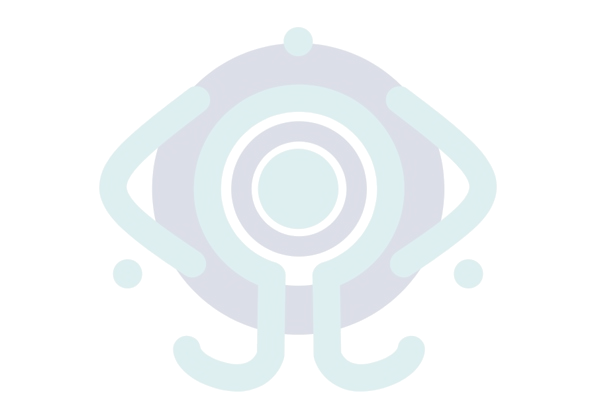

# Ariel Paredes Lozada

### Software engineering student aiming for roles in data analysis, DevOps, or operating systems

Software engineering student at <a href="https://www.uta.edu.ec">Universidad Técnica de Ambato</a>

## About

Software engineering student at Universidad Técnica de Ambato, building hands-on experience with deployed systems, academic platforms, and hackathon projects. Looking for opportunities in data analysis, DevOps, or operating systems.

Graduation date, availability, and work modality: PLACEHOLDER_PAPU

## Tech Stack

<table>
  <tr>
    <th colspan="4">
      

      <kbd>Backend</kbd>
      

    </th>
  </tr>
  <tr>
    <th><kbd>.NET</kbd></th>
    <th><kbd>Spring Boot</kbd></th>
    <th><kbd>Express</kbd></th>
    <th></th>
  </tr>
  <tr>
    <th colspan="3">
      

      <kbd>Frontend</kbd>
      

    </th>
  </tr>
  <tr>
    <th><kbd>React</kbd></th>
    <th><kbd>Angular</kbd></th>
    <th><kbd>Flutter</kbd></th>
  </tr>
  <tr>
    <th colspan="3">
      

      <kbd>Databases</kbd>
      

    </th>
  </tr>
  <tr>
    <th><kbd>PostgreSQL</kbd></th>
    <th><kbd>MySQL</kbd></th>
    <th><kbd>Oracle</kbd></th>
  </tr>
  <tr>
    <th colspan="3">
      

      <kbd>DevOps</kbd>
      

    </th>
  </tr>
  <tr>
    <th><kbd>Docker</kbd></th>
    <th><kbd>Linux</kbd></th>
    <th><kbd>GitHub Actions</kbd></th>
  </tr>
  <tr>
    <th colspan="5">
      

      <kbd>Languages</kbd>
      

    </th>
  </tr>
  <tr>
    <th></th>
    <th><kbd>C#</kbd></th>
    <th></th>
    <th></th>
    <th></th>
  </tr>
</table>

## Proyectos

<table>
  <tr>
    <th><a href="https://github.com/ArielParedesLozada/Tamagochi-Javascript.git">Tamagochi Web con Javascript</a></th>
  </tr>
  <tr>
    <th><a href="https://github.com/ArielParedesLozada/De-A-a-Z-DS.git">Juego de la A a la Z</a></th>
  </tr>
  <tr>
    <th><a href="https://github.com/ArielParedesLozada/AI-Python.git">Investigación de AI usando Python</a></th>
  </tr>
</table>

## Contactos

